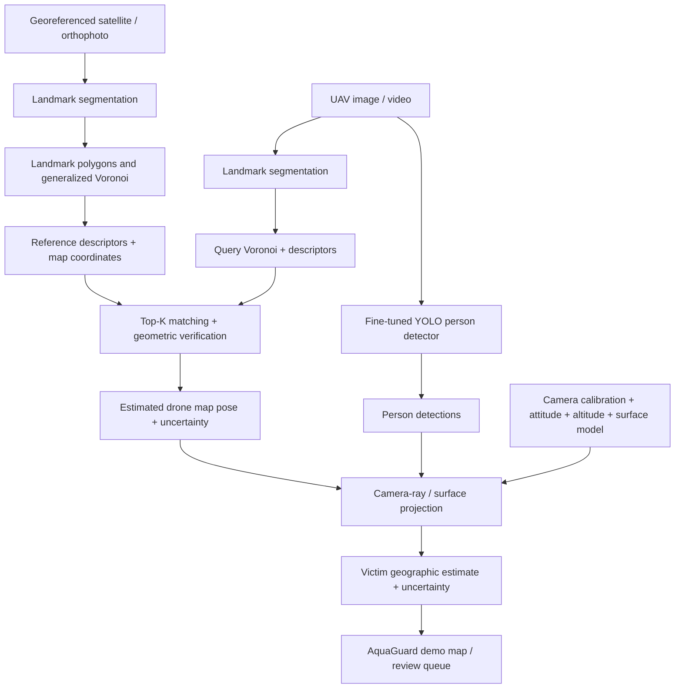

# AquaGuard GeoRescue

**Vision-Based Victim Detection and GNSS-Denied Geolocation for Flood Search and Rescue**

> **Status:** Concept / Early Planning — personal computer vision project. No end-to-end system or performance results are claimed yet.

This folder owns the GeoRescue prototype. See the [repository overview](../README.md), [AquaGuard platform documentation](../docs/AquaGuard_docs/README.md), and [GeoRescue onboarding prompt](docs/CODEX_PROJECT_ONBOARDING_PROMPT.md).

## Overview

AquaGuard GeoRescue is a proposed drone-assisted flood search-and-rescue computer vision pipeline. It aims to detect people in flood-affected areas and estimate their locations on a pre-georeferenced map, even when the drone cannot rely on GNSS/GPS.

The system combines **fine-tuned deep learning models** for scene understanding and human detection with **geometry-based visual localization** inspired by the *Generalized Voronoi–Integral Descriptors for GNSS-Denied UAV Localization from a Single Aerial Image* method.

The initial goal is an **offline, reproducible prototype using satellite imagery and recorded UAV images/video**. It is not intended as an autonomous flight controller or a deployment-ready emergency-response system.

## Problem Statement

Floods can interrupt cellular infrastructure and make it difficult for residents to send their locations. A UAV can observe affected areas from above, but detecting someone in an image does not automatically reveal that person's real-world coordinates. GNSS-denied navigation introduces an additional challenge: the drone may not know its own geographic position.

**Primary question:** Can relatively stable visual landmarks (e.g., roofs, tree-canopy clusters and bridges), mapped in advance, help localize a drone without GNSS and convert detections of people into useful geographic rescue leads?

**Important distinction:** GNSS-denied localization and network-denied communication are different problems. The first prototype targets GNSS-independent position estimation with local/offline processing. Delivery to command staff without Internet requires a separate radio/mesh link, or store-and-forward when a link becomes available.

## Proposed Approach

### 1. Offline reference-map preparation

1. Obtain georeferenced satellite imagery or orthophotos for a bounded test area.
2. Segment relatively stable landmarks: **building roofs, tree canopies**, and, where labels allow, bridges and permanent waterways.
3. Convert segmentation masks into cleaned, georeferenced landmark polygons/regions.
4. Construct a **generalized Voronoi diagram** using distances to segmented regions; extract selected order-three candidates and optional candidates along **stable** boundaries.
5. Compute local geometry/appearance or semantic integral descriptors around candidates.
6. Store reference descriptors, candidate image positions, map coordinates and map metadata in a local database.

### 2. Online/query-image localization

1. Load a recorded UAV image/frame.
2. Segment the same landmark classes.
3. Build query candidates and descriptors compatible with the reference database.
4. Retrieve Top-K descriptor matches; verify geometric consistency where possible.
5. Estimate the drone's **2D position** and, as an implementation extension, scale and heading/orientation. Report uncertainty and reject ambiguous matches.

The underlying Feature 4 approach performs candidate-centric descriptor matching to retrieve a map location. **It does not by itself guarantee full 6-DoF UAV pose**, nor has it established practical flood-scene accuracy. Estimating heading, scale and camera pose is additional engineering work.

### 3. Flood victim detection

1. Start from a pretrained **YOLO** object detector.
2. Fine-tune using appropriately licensed, annotated aerial/flood imagery of people, including small objects, rooftop/boat/water contexts and difficult illumination when available.
3. Return person boxes, scores and optionally tracks across frames.
4. Review low-confidence detections rather than treating every prediction as a verified rescue case.

### 4. Victim geolocation

1. Calibrate the camera (intrinsics, lens distortion and camera-to-drone alignment).
2. Use the estimated drone position **plus attitude, heading, altitude and camera geometry**.
3. Project a detected person's image location onto an assumed/estimated surface (ground, rooftop or flood-water level where known).
4. Transform the intersection into reference-map coordinates, then latitude/longitude.
5. Attach an uncertainty region reflecting localization error, pose uncertainty, surface-height error and detection uncertainty.

A 2D Voronoi match alone is **insufficient** to obtain a reliable person coordinate. This module is a core validation requirement, not a trivial post-processing step.

### 5. AquaGuard presentation (prototype)

Plot candidate victim locations and uncertainty areas on an offline/local or connected map UI, with links to evidence frames and review status. Integration with AquaGuard's existing rescue workflows can be explored once the geolocation pipeline is validated.

## Conceptual Pipeline



## ML / DL Components

| Task | Initial model direction | Training approach | Deliverable |
|---|---|---|---|
| Landmark segmentation | SegFormer (or comparable semantic segmentation model) | Fine-tune on satellite and UAV imagery, testing cross-domain performance | Masks for roofs, canopies and selected stable landmarks |
| Person detection | YOLO (choose version based on available hardware and licenses) | Fine-tune pretrained weights on aerial/flood-person annotations | Person bounding boxes and confidence |
| Localization | Generalized Voronoi + integral descriptors | **No learned matcher required for MVP** | Top-K reference matches and location estimates |
| Optional later | Learned re-ranker / descriptor or VIO fusion | Only if baseline analysis justifies added complexity | Improved candidate verification or drift mitigation |

**Training priorities:** Build a reproducible dataset split; document label taxonomy, annotation sources and usage rights; address domain shift between satellite and UAV imagery; avoid leakage across nearby tiles or video frames; preserve untouched evaluation regions/flights.

## Reuse of the Two Reference Manuscripts

- **Feature 4 — _Generalized Voronoi–Integral Descriptors for GNSS-Denied UAV Localization from a Single Aerial Image_ (Phan Thanh An et al.)**: Conceptual basis for distance-to-region Voronoi candidate generation, geometry/appearance integral descriptors, reference database and query matching. The Cần Giờ example is a numerical demonstration, **not** a validated localization benchmark.
- **Feature 1b — _Lebesgue Integral Shape Descriptors: Lipschitz Stability and Poincaré Inequalities with Applications to UAV Localization_ (Phan Thanh An et al., 2026)**: Theoretical motivation for visibility-region descriptors, local stability under stated assumptions and discrete-sampling convergence. The reported `O(h)` bound concerns **descriptor approximation under regularity assumptions**, **not** an `O(h)` bound on GPS-free position error.

This project is an **application/engineering adaptation**. It does not claim authorship of, or novelty in, the underlying papers' mathematics. Reuse of existing research code, figures or data requires the relevant permission and attribution.

## Why Flood Environments Are Challenging

- Flooded roads, changing water boundaries, reflections and debris can invalidate reference appearance.
- Repetitive buildings/trees create visually ambiguous positions.
- Different satellite and UAV scales, viewpoints, seasons and camera characteristics complicate matching.
- Wind, low light, rain and motion blur degrade detection and segmentation.
- Humans can be obscured by roofs, vegetation and water; thermal imagery, if later adopted, has its own limitations.
- A detection bounding box alone is not a surface point. Unknown roof/water height and camera orientation can cause significant geolocation error.
- Safety-critical operation requires conservative thresholds, uncertainty reporting and human confirmation.

**Design choice:** Prefer stable man-made/vegetation landmark geometry; do not treat the *current flood boundary* or water color as a stable primary localization anchor.

## MVP Scope

**In scope**

- One small, preselected, georeferenced test region.
- Offline satellite/UAV images or recorded video.
- Two fine-tuned models: landmark segmentation and person detection.
- Geometry-based Top-K localization with a visible evaluation against known coordinates.
- Victim-coordinate projection **only when sufficient pose/surface information is available**.
- Local demo map and reproducible scripts/results.

**Out of scope for the first version**

- Autonomous drone control, path planning and flight safety assurance.
- Multi-drone collaboration.
- Real radio/LoRa/mesh communications and disaster-field operations.
- A novel neural localization architecture or academic publication.
- Unqualified rescue alerts or claimed meter-level precision before testing.

## Proposed Milestones

- [ ] **M0 — Repository & data audit:** inspect available Feature 4 code, licenses and reference imagery; select test region and define ground-truth protocol.
- [ ] **M1 — Geometry baseline:** build georeferenced reference descriptors and evaluate query Top-1/Top-5 localization.
- [ ] **M2 — Semantic segmentation:** prepare annotated data and fine-tune/test SegFormer; run masks through geometry baseline.
- [ ] **M3 — Human detection:** fine-tune/test YOLO on aerial/flood imagery.
- [ ] **M4 — Victim geolocation:** integrate calibration/pose/surface estimates; report coordinates **and uncertainty** against held-out annotated ground truth.
- [ ] **M5 — Demo:** display trajectories, evidence frames, detection markers and uncertainty regions in a local/AquaGuard-compatible interface.
- [ ] **M6 — Optional extensions:** VIO, matching refinements, thermal data, communication relay and real UAV testing.

## Evaluation Plan

| Module | Suggested metrics |
|---|---|
| Landmark segmentation | Class-wise IoU, mIoU, F1, cross-domain error |
| Human detection | Precision, Recall, mAP50/mAP50-95, small-person performance, false-positive rate, latency |
| Drone localization | Top-1/Top-5 retrieval, position error in metres, success within 5/10/20 m, abstention rate, runtime |
| Victim geolocation | Median/90th-percentile error in metres, uncertainty calibration and coverage, false-alert review rate |
| End-to-end prototype | FPS/latency, memory use, failure cases and reproducibility |

**Recommended comparisons:** Feature 4 geometry-only baseline vs semantic-geometry adaptation; pretrained vs fine-tuned models; clear-weather vs flood-like imagery; different heights/viewpoints; explicit ambiguous-match cases.

## Proposed Technology Stack

- **Training/inference:** Python, PyTorch, Hugging Face Transformers (SegFormer), Ultralytics or another suitable YOLO implementation.
- **Geometry / geospatial:** OpenCV, NumPy, SciPy, Shapely, Rasterio, GeoPandas, GDAL/PROJ when needed.
- **Data and experiments:** GeoTIFF/GeoJSON, YAML configuration, local reference descriptor store, evaluation scripts and experiment logs.
- **Demo:** map viewer (e.g., Leaflet, already used by AquaGuard) with optional API integration.

*These are proposed tools, not claims about the current repository's dependencies.*

## Folder Organization

The current folder contains this README and `docs/CODEX_PROJECT_ONBOARDING_PROMPT.md`. Add implementation directories when they contain actual work; the source modules below remain planned.

```text
georescue/
├── README.md
├── docs/
│   ├── CODEX_PROJECT_ONBOARDING_PROMPT.md
│   ├── references/            # manuscripts when available and permitted
│   ├── architecture.md       # planned
│   ├── data_protocol.md      # planned
│   └── evaluation.md         # planned
├── configs/
├── data/                   # datasets ignored from Git
├── outputs/                # generated results ignored from Git
├── src/
│   └── aquaguard_georescue/
│       ├── localization/
│       ├── segmentation/
│       ├── detection/
│       ├── geolocation/
│       └── integration/
├── scripts/
├── tests/
├── notebooks/
└── demo/
```

AquaGuard's existing `frontend/`, `backend/`, `hardware/`, and `infrastructure/` remain at the repository root. Keep GeoRescue's Python environment and processing pipeline within this folder; connect to the platform through the future integration module.

The two reference manuscripts, upstream research code, datasets, and model weights are not currently included. Record provenance and reuse permissions before adding them. The intended location for manuscripts is `docs/references/`.

## References & Attribution

1. Phan Thanh An et al., *Generalized Voronoi–Integral Descriptors for GNSS-Denied UAV Localization from a Single Aerial Image* — supplied Feature 4 manuscript.
2. Phan Thanh An et al., *Lebesgue Integral Shape Descriptors: Lipschitz Stability and Poincaré Inequalities with Applications to UAV Localization* (Aug. 2026) — supplied Feature 1b manuscript.
3. [AquaGuard](https://aquaguard.vn) — flood-alert and rescue coordination platform; integration is planned, not implemented by this concept README.

---

**Current outcome:** An implementation plan, **not yet a working GNSS-free rescue platform**. The first engineering priority is to establish ground truth and reproduce the localization baseline before adding model training.
